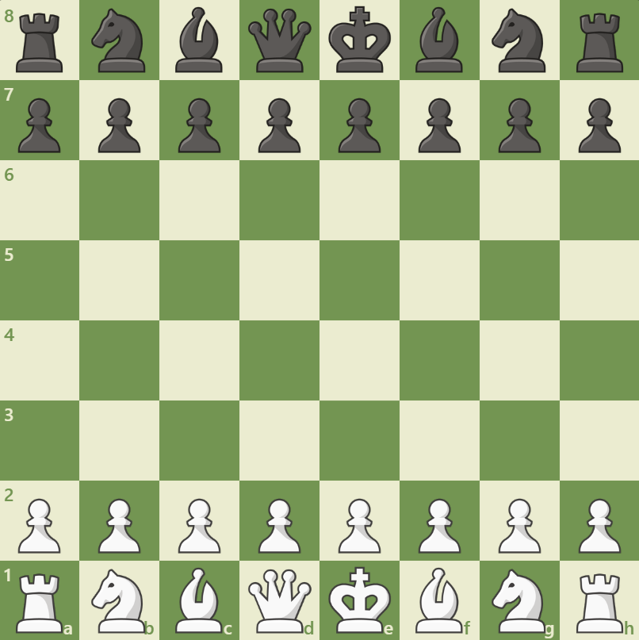

# Assistente de Xadrez

Leitura automática do tabuleiro do chess.com via OpenCV e sugestão da melhor
jogada com Stockfish, exibida em um overlay sempre no topo.



## Como funciona

1. Captura a tela com `mss` e localiza o tabuleiro automaticamente.
2. Calibra a grade (origem e tamanho da casa) sem configuração manual.
3. Segmenta cada casa e reconhece a peça por template matching, usando as
   imagens de `referencias/`.
4. Trata elementos de interface que se sobrepõem às peças (selo `?!` e ícone
   de livro de abertura).
5. Confirma a posição em duas leituras. Identifica a vez pelo destaque do último
   lance ou pelas regras da posição e acompanha os lances legais a partir daí.
6. Consulta o Stockfish via `stockfish_helper.js` e mostra a jogada no overlay.

## Requisitos

- Windows 10/11 (testado no Windows 11)
- Python 3.11+ (testado com 3.12)
- Node.js 18+ (testado com 24)
- Chrome com o chess.com aberto
- Tema padrão do chess.com (casas verdes)
- Peças do jogador na parte de baixo do tabuleiro

Recomendações: mantenha o zoom do navegador em 100%, não mova nem redimensione
a janela durante a partida e não minimize o Chrome.

## Instalação

```bash
git clone https://github.com/miguelfmaggi15-lang/Assistente_Xadrez.git
cd Assistente_Xadrez
python -m venv .venv
.venv\Scripts\activate
pip install -r requirements.txt
npm install
```

O `npm install` baixa o Stockfish.js (WASM), que ocupa cerca de 196 MB em
`node_modules/`.

## Uso

1. Abra uma partida contra um bot no chess.com pelo Chrome. Você pode iniciar
   o assistente com a partida já em andamento.
2. Confira que o tabuleiro está visível e com as suas peças embaixo.
3. Execute:

```bash
python assistente_automatico.py
```

Se a vez estiver indefinida, o assistente aguarda um lance visível antes de
mostrar uma sugestão. Mantenha o destaque do último lance e as coordenadas
visíveis. Se as coordenadas estiverem ocultas e a orientação for lida errada,
passe `--orientacao brancas` ou `--orientacao pretas`, conforme a cor embaixo.

Pressione `Ctrl+C` no terminal para encerrar. O programa também encerra sozinho
quando confirma um fim de partida detectável pela posição ou pelos lances
acompanhados.

Na sua vez, a casa de origem fica azul com uma borda e a de destino fica âmbar
com duas bordas. As marcações são translúcidas e os cliques passam para o
tabuleiro normalmente. O painel mostra as duas coordenadas nas mesmas cores,
a peça sugerida e o estado da leitura.

Ajustes comuns ficam no topo de `assistente_automatico.py`:

- `PROFUNDIDADE_STOCKFISH` (padrão 15)
- `TEMPO_STOCKFISH_MS` (padrão 500 ms)
- `INTERVALO_LEITURA` (padrão 0,30 s entre leituras)
- `LIMIAR_TEMPLATE` (padrão 0.40)

Para dar mais tempo ao Stockfish em posições complexas, rode
`python assistente_automatico.py --tempo-stockfish-ms 1500`.

## Testes

A suíte monta tabuleiros sintéticos, simula selos de interface e usa capturas
reais em `fixtures/`:

```bash
python depurar_deteccao.py --teste
```

Para analisar uma imagem específica:

```bash
python depurar_deteccao.py --imagem caminho/para/imagem.png
```

## Estrutura

```text
assistente_automatico.py  Entrada principal e overlay
painel.py                 Painel de estado e sugestão de lance
destaques.py              Marcações sobre as casas no Windows
deteccao.py               Visão computacional e reconhecimento das peças
stockfish_helper.js       Ponte entre o Python e o Stockfish (Node.js)
depurar_deteccao.py       Suíte de regressão e depuração
referencias/              Imagens das 12 peças do tema padrão
fixtures/                 Imagens usadas nos testes
```

## Limitações

- O reconhecimento depende do tema padrão do chess.com. Para outro tema, as
  imagens em `referencias/` precisam ser recapturadas.
- O tabuleiro precisa estar totalmente visível e sem sobreposição de janelas.
- A sugestão é mostrada quando for a vez da cor que está embaixo.
- Ao começar no meio da partida, o histórico anterior e os direitos de roque
  podem ser desconhecidos. Os direitos passam a ser acompanhados quando a
  leitura começa na posição inicial.

## Aviso

Projeto educacional, sem vínculo com o chess.com. Usar assistência de engine em
partidas ao vivo viola a política de fair play do chess.com e pode resultar em
suspensão da conta. Use apenas em análise offline ou contra bots.

As imagens em `referencias/` foram capturadas da interface do chess.com e
pertencem ao chess.com; estão incluídas apenas para permitir o template
matching.

## Licença

Código sob a licença MIT. Veja [LICENSE](LICENSE).

O Stockfish.js, baixado via npm, é distribuído sob a licença GPL-3.0.

---

## English summary

Automatic chess.com board reader that captures the screen, detects the board
with OpenCV, recognizes the pieces by template matching and suggests the best
move with Stockfish through a Node.js helper. The suggestion is shown in an
always-on-top overlay.

Requirements: Windows 10/11, Python 3.11+, Node.js 18+ and Chrome with
chess.com open using the default green theme. Install with
`pip install -r requirements.txt` and `npm install`, then run
`python assistente_automatico.py`.

Using engine assistance in live games violates chess.com's Fair Play policy.
This project is intended for study, offline analysis and games against bots.
